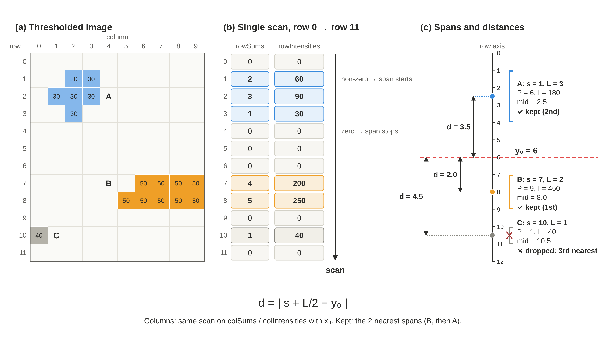
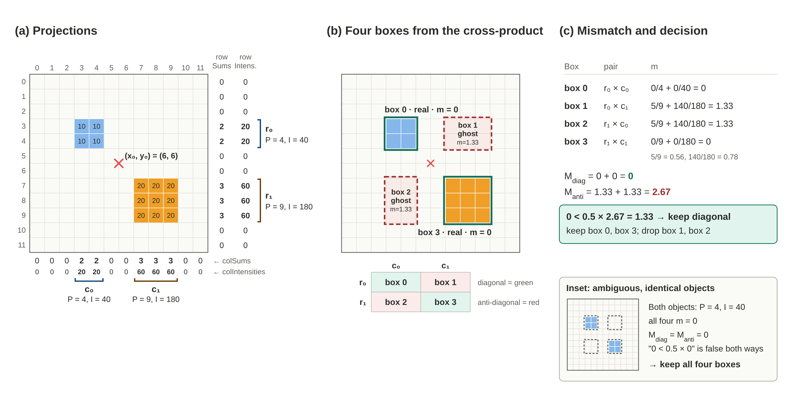
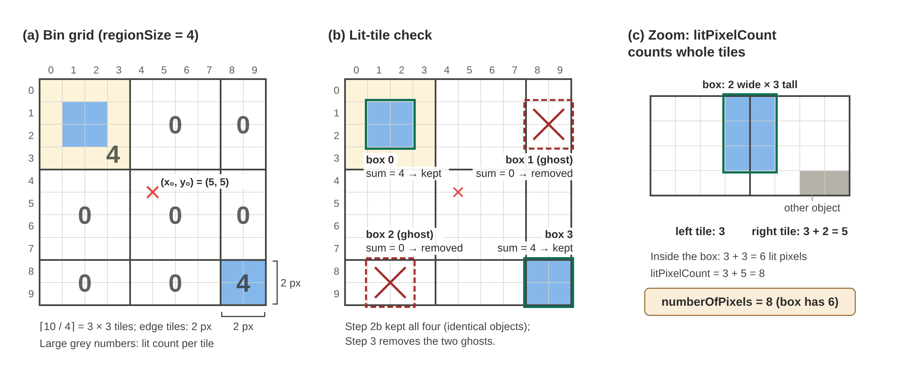

.. raw:: latex

    {\LARGE \textbf{regionsOfInterestPrune}}
    \renewcommand{\arraystretch}{1.6}

Executive Summary
-----------------

This module finds the bounding boxes of the bright objects in one camera image. It does not read the image. It reads
the row and column sums that ``fpgaImagePipeline`` calculates from the image, and the bin grid of lit pixels per tile.
It then publishes a maximum of two boxes. The boxes are sorted by the distance of their centers to a reference point
:math:`(x_0, y_0)`. The first box (R1) is the box nearest to the reference point.

The module is between the image pipeline and the region-of-interest selection::

    fpgaImagePipeline  ->  regionsOfInterestPrune  ->  ROI selection / centroiding

- **Input:** the row and column sums and intensities, and the bin grid of lit pixels per tile.
- **Output:** a maximum of two boxes, nearest to :math:`(x_0, y_0)` first.

Spans, Boxes and Ghost Boxes
~~~~~~~~~~~~~~~~~~~~~~~~~~~~

- A **row sum** is the number of pixels above the threshold in one image row. A **column sum** is the same for one
  image column. The matching **intensities** are the sums of the pixel values above the threshold.
- A **span** is a run of adjacent rows (or columns) with a non-zero sum.
- A **box** is the crossing of one row span and one column span.
- A **ghost box** is a box that contains no object. Two objects that do not share rows or columns make two row spans
  and two column spans. Thus, the four crossings give the two real boxes and two ghost boxes. The module removes
  ghost boxes with the projections and with the bin grid.

Module Architecture
-------------------

The module has two layers:

- The **algorithm** (``regionsOfInterestPruneAlgorithm.h``/``.cpp``) has no framework dependencies. It keeps a
  validated ``RegionsOfInterestPruneConfig``. Its ``update()`` receives the row and column arrays and the bin grid of
  one image, and it gives a ``RoiCandidates`` list. ``update()`` does not cause an exception and does not allocate
  memory. The algorithm has no runtime state. Thus, the result of an update does not change the result of the next
  update.
- The **Xmera adapter** (``regionsOfInterestPrune.h``/``.cpp``) is a subclass of ``SysModel`` and does all of the
  messaging. At each update, it reads the two input messages, copies the lit pixel counts of the bin grid into one
  array, and calls the algorithm. It then writes the boxes to ``regionsIdentifiedOutMsg``. The adapter writes the
  output message at each update, also when there are no boxes.

The **Adamant adapter** is a C shim. It gives Ada FFI access to the algorithm through an opaque handle.

- The C functions are in ``regionsOfInterestPruneAlgorithm_c.h``/``.cpp``.
- The types at the boundary are in ``regionsOfInterestPruneTypes.h``.
- ``validateConfig()`` does not cause an exception. Ada uses it to make sure that a configuration is valid before
  it calls ``create()`` or ``setConfig()``, which cause an exception.
- The candidate array has 4 slots, because Step 2 can make 4 boxes. ``update()`` returns a maximum of 2 boxes in
  the first slots, and the other slots are zero. ``getMaxCandidatesCount()`` gives the number of slots (4), not the
  number of boxes.

Adapter Layer
-------------

The configuration uses a two-phase initialization. First, the caller sets the public properties. Then ``reset()``
makes sure that the two input messages are connected, makes the configuration, and makes the algorithm.

.. list-table:: Module I/O Messages
    :widths: 28 34 38
    :header-rows: 1

    * - Msg Variable Name
      - Msg Type
      - Description
    * - ``rowColSumInMsg``
      - :ref:`FpgaRowColSumMsgF32Payload`
      - Image size, and the lit pixel count and intensity of each row and each column.
    * - ``binGridInMsg``
      - :ref:`FpgaBinGridMsgF32Payload`
      - The image divided into square tiles, with the lit pixel count of each tile. It must cover the image of
        ``rowColSumInMsg``.
    * - ``regionsIdentifiedOutMsg``
      - :ref:`RegionsIdentifiedMsgF32Payload`
      - A maximum of two boxes, nearest to the reference point first.

Published Fields
~~~~~~~~~~~~~~~~

``numberOfRegions`` is the number of valid boxes (0, 1 or 2). For each box:

- ``cornerX`` is the first column and ``cornerY`` is the first row of the box.
- ``width`` and ``height`` are the size of the box in pixels.
- ``numberOfPixels`` is the lit pixel count of all of the tiles that the box covers (Step 3).
- ``timeTag`` is the simulation time of the update, in seconds.

The entries after ``numberOfRegions`` are zero.

Configuration
~~~~~~~~~~~~~

``reset()`` validates the configuration parameters when it makes the algorithm configuration. A value that is not in
the valid range causes an ``fsw::invalid_argument`` exception, and the module does not make the algorithm.

.. list-table:: Configuration parameters
    :widths: 28 24 48
    :header-rows: 1

    * - Parameter
      - Valid range
      - Description
    * - ``x0``
      - 0 to 4096 (``MAX_IMAGE_COLS``)
      - [px] Column of the reference point. The default is 2048.
    * - ``y0``
      - 0 to 3000 (``MAX_IMAGE_ROWS``)
      - [px] Row of the reference point. The default is 1500.
    * - ``alphaAreaPruneScaling``
      - :math:`-\infty` to 2
      - [-] Order of the boxes at the same distance. Below 0, the cost function is bypassed. From 0 to 2, the
        cost exponent is :math:`\alpha - 1`. Values above 2, :math:`+\infty` and NaN are not valid. The default
        is 1.

``x0`` and ``y0`` are a column and a row of the image in ``rowColSumInMsg``. ``cornerX`` and ``cornerY`` use the
same columns and rows.

Two-Phase Initialization
~~~~~~~~~~~~~~~~~~~~~~~~

First, set the public configuration properties and connect the two input messages. Then ``reset()`` makes and
validates the configuration.

.. code-block:: python

    pruner = regionsOfInterestPruneF32.RegionsOfInterestPrune()
    pruner.x0 = 341                      # [px] reference column
    pruner.y0 = 250                      # [px] reference row
    pruner.alphaAreaPruneScaling = 2.0   # [-] on a tie, prefer the denser box
    pruner.rowColSumInMsg.subscribeTo(pipeline.rowColSumOutMsg)
    pruner.binGridInMsg.subscribeTo(pipeline.binGridOutMsg)

    sim.AddModelToTask(task_name, pruner)
    sim.InitializeSimulation()
    sim.ExecuteSimulation()

    msg = pruner.regionsIdentifiedOutMsg.read()   # msg.cornerX[0], ... for R1

To give changed ``x0``, ``y0`` and ``alphaAreaPruneScaling`` values to a running algorithm, call
``reconfigure()``. The change has no effect until this call.

The adapter causes an exception in these cases:

- ``reset()`` causes an ``std::invalid_argument`` if ``rowColSumInMsg`` or ``binGridInMsg`` is not connected.
- ``updateState()`` and ``reconfigure()`` cause an ``XmeraLifecycleException`` if you call them before
  ``reset()``.

From Python, an invalid configuration has two different results:

- Through ``reset()`` (for example in ``InitializeSimulation()``), it causes a Python ``RuntimeError``.
- Through ``reconfigure()`` or ``RegionsOfInterestPruneConfig.create()`` called directly, it stops the Python
  process, because the module has no SWIG exception mapping. Before these calls, make sure that the values are
  valid with ``isValidX0()``, ``isValidY0()`` and ``isValidAlphaAreaPruneScaling()``.

Detailed Module Description
---------------------------

The algorithm has six steps. In this section, :math:`(x_0, y_0)` is the reference point, :math:`x` is a column and
:math:`y` is a row.

Step 1: Find the Nearest Spans
~~~~~~~~~~~~~~~~~~~~~~~~~~~~~~

The algorithm scans ``rowSums`` one time from the start to the end. A span starts at a non-zero entry and stops at
the next zero entry. During the scan, the algorithm adds the entries of the span to get the lit pixel count of the
span, :math:`P`. It also adds the matching entries of ``rowIntensities`` to get the intensity of the span,
:math:`I`. The algorithm then does the same scan of ``colSums`` and ``colIntensities``.

The distance of a span is the distance from its midpoint to the reference coordinate:

.. math::

    d = \left| \, s + \tfrac{L}{2} - y_0 \, \right|

where :math:`s` is the first row of the span and :math:`L` is its length. For a column span, :math:`x_0` replaces
:math:`y_0`.

- The algorithm keeps only the ``ROW_SPANS_MAX`` (2) row spans and the ``COL_SPANS_MAX`` (2) column spans with the
  smallest distance.
- It keeps these spans in a small list that is sorted by distance. Thus, the algorithm does not keep all of the
  spans, and the memory does not change with the image size.
- If two spans have the same distance at the cutoff, the earlier span stays.

    Step 1 on the row axis. One scan finds three spans, and each span adds its row counts (:math:`P`) and
    intensities (:math:`I`). The two spans with the midpoints nearest to :math:`y_0 = 6` (B, then A) are kept, and
    C is dropped.

Step 2: Make the Boxes
~~~~~~~~~~~~~~~~~~~~~~

Each kept row span crosses each kept column span. Each crossing is a box. Thus, there are a maximum of four boxes.

- The box starts at the first row of the row span and at the first column of the column span.
- Its height is the length of the row span, and its width is the length of the column span.
- The boxes are in this order: row span 0 with column span 0, row span 0 with column span 1, row span 1 with column
  span 0, row span 1 with column span 1. Row span 0 is the nearest row span.

The intensity of a box is

.. math::

    I_\text{box} = \min\left(I_\text{row span}, \; I_\text{col span}\right)

The row span also contains the light of the pixels outside the column span, and the column span also contains the
light outside the row span. Thus, :math:`I_\text{box}` is the smallest upper bound that the projections give. The
true intensity in the box can be smaller, but not larger.

Step 2b: Remove the Ghost Boxes
~~~~~~~~~~~~~~~~~~~~~~~~~~~~~~~

This step operates only when there are two row spans and two column spans. With other numbers of spans, a ghost box
cannot occur, and the step does not change the boxes.

Two objects A and B that do not share rows or columns give four boxes. Two boxes are real, and two boxes are ghosts.
The real boxes are one of the two pairings of the spans::

    rows \ cols     col span 0    col span 1
    row span 0      box 0         box 1
    row span 1      box 2         box 3

    diagonal pairing:       box 0 and box 3
    anti-diagonal pairing:  box 1 and box 2

The row span and the column span of a real box contain the same object. Thus, their lit pixel counts are almost
equal, and their intensities are almost equal. A ghost box pairs the rows of one object with the columns of the
other object. The mismatch of a row span :math:`r` and a column span :math:`c` is

.. math::

    m(r, c) = \frac{|P_r - P_c|}{\max(P_r, P_c)} + \frac{|I_r - I_c|}{\max(I_r, I_c)}

Each fraction is zero when both values are zero. The mismatch of a pairing is the sum of the mismatch of its two
boxes:

.. math::

    M_\text{diag} = m(r_0, c_0) + m(r_1, c_1), \qquad M_\text{anti} = m(r_0, c_1) + m(r_1, c_0)

- The algorithm keeps the diagonal pairing (boxes 0 and 3) if :math:`M_\text{diag} < 0.5 \, M_\text{anti}`.
- It keeps the anti-diagonal pairing (boxes 1 and 2) if :math:`M_\text{anti} < 0.5 \, M_\text{diag}`.
- In all other cases, the projections cannot identify the real boxes, and the algorithm keeps all four boxes.

The factor 0.5 is ``GHOST_PAIRING_MARGIN``. The comparison is strict: a ratio of exactly 0.5 keeps all four boxes.

    Step 2b. Two objects give two row spans and two column spans, so the cross-product makes four boxes. The real
    boxes pair spans with the same pixel count and intensity (:math:`m = 0`). The ghost boxes pair the rows of one
    object with the columns of the other (:math:`m = 1.33`). Because :math:`M_\text{diag} = 0` is less than
    :math:`0.5 \, M_\text{anti}`, the diagonal boxes are kept and the ghost boxes are removed. Inset: identical
    objects make each mismatch zero, so all four boxes are kept.

Step 3: Remove the Boxes on Unlit Tiles
~~~~~~~~~~~~~~~~~~~~~~~~~~~~~~~~~~~~~~~

The bin grid divides the image into square tiles of ``regionSize`` pixels. The tiles at the right and bottom edges
can be smaller.

- For each box, the algorithm adds the lit pixel counts of all of the tiles that the box covers.
- If the sum is zero, the box is not on a lit pixel, and the algorithm removes it. A ghost box of two objects in
  different tiles is usually on unlit tiles. Thus, this step removes most of the ghost boxes that Step 2b keeps.
- The sum is the ``litPixelCount`` of the box, and the adapter publishes it as ``numberOfPixels``. The sum includes
  all of the pixels of each covered tile, also the pixels outside the box. Thus, it can be larger than the number
  of lit pixels in the box.

    Step 3. The bin grid has 3 x 3 tiles of 4 pixels, and the edge tiles are 2 pixels wide. Step 2b kept all four
    boxes of the two identical objects. The ghost boxes 1 and 2 cover only unlit tiles (sum = 0) and are removed.
    The real boxes 0 and 3 cover lit tiles and are kept. Zoom: ``litPixelCount`` adds the full covered tiles, so it
    can be larger than the number of lit pixels in the box (8 against 6).

Step 4: Calculate the Cost
~~~~~~~~~~~~~~~~~~~~~~~~~~

The parameter ``alphaAreaPruneScaling`` (:math:`\alpha`) sets the order of two boxes at the same distance from the
reference point. A negative value bypasses this cost function.

For each box, the algorithm calculates the scaled intensity

.. math::

    S = \frac{I_\text{box}}{A^{\,\alpha - 1}}, \qquad A = \text{width} \cdot \text{height}

where :math:`\alpha` is ``alphaAreaPruneScaling``. The exponent :math:`\alpha - 1` is in :math:`[-1, 1]`. When
:math:`\alpha` is less than zero, the cost function is bypassed: the algorithm does not do this step, and :math:`S`
is zero for each box.

The table that follows shows the effect of :math:`\alpha` on two boxes at the same distance.

.. list-table:: Effect of alphaAreaPruneScaling
    :widths: 20 25 55
    :header-rows: 1

    * - :math:`\alpha`
      - Scaled intensity :math:`S`
      - First box
    * - less than 0
      - 0 (bypassed)
      - The box of the nearer row span, then of the nearer column span (order of Step 2).
    * - 0
      - :math:`I \cdot A`
      - The box with the larger product of intensity and area. Large boxes are preferred.
    * - 1 (default)
      - :math:`I`
      - The brighter box. The area has no effect.
    * - 2
      - :math:`I / A`
      - The box with the larger mean intensity per pixel. Small boxes are preferred.

Step 5: Sort the Boxes
~~~~~~~~~~~~~~~~~~~~~~

The algorithm sorts the boxes by the distance from the box center to the reference point, from the nearest to the
farthest. The box center is :math:`(\text{col} + \text{width}/2, \; \text{row} + \text{height}/2)`. The algorithm
uses the square of the distance, because only the order is necessary.

- When two boxes have the same distance, the box with the larger :math:`S` is first.
- When the cost function is bypassed, the two boxes stay in the order of Step 2. Thus, the box of the nearer row
  span is first.
- The sort is stable, so boxes with the same distance and the same :math:`S` also stay in the order of Step 2.

The distance is always the first key. Thus, :math:`\alpha` changes the order only of boxes with exactly the same
distance.

Step 6: Keep the First Two Boxes
~~~~~~~~~~~~~~~~~~~~~~~~~~~~~~~~

The algorithm keeps the first ``ROI_CANDIDATES_OUT_MAX`` (2) boxes of the sorted list. It sets the entries after
these boxes to zero. Thus, a reader of the full array does not see the removed boxes.

Assumptions and Limitations
---------------------------

- **Some ghost boxes stay.** When two objects have almost the same lit pixel count and intensity, Step 2b cannot
  identify the real boxes and keeps all four. If the two objects are in the same lit tile, Step 3 also keeps the
  ghost boxes. A ghost box can then be R1 or R2.
- **Step 2b can remove the real boxes.** When one span contains two objects, its totals do not agree with one object.
  The wrong pairing can then have the smaller mismatch, and the algorithm removes the real boxes, also the box of the
  target.
- **The module does not have a minimum object size.** The distance is always the first sort key. Thus, a single lit
  pixel, for example a hot pixel or a star, that is nearer to the reference point than the target becomes R1.
- **Single precision.** The module does its calculations in single precision (``float``), except the intensity
  sums, which are ``uint64_t`` so that they do not overflow. For boxes more than about 2000 px from the reference
  point, two squared distances that differ by less than about 2 px\ :sup:`2` can become equal. The cost function
  then sets their order.
